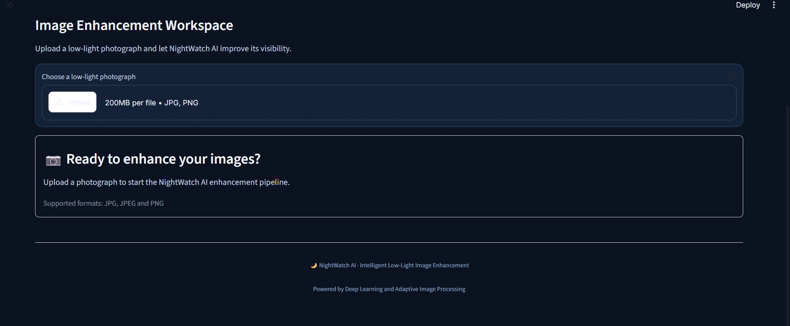
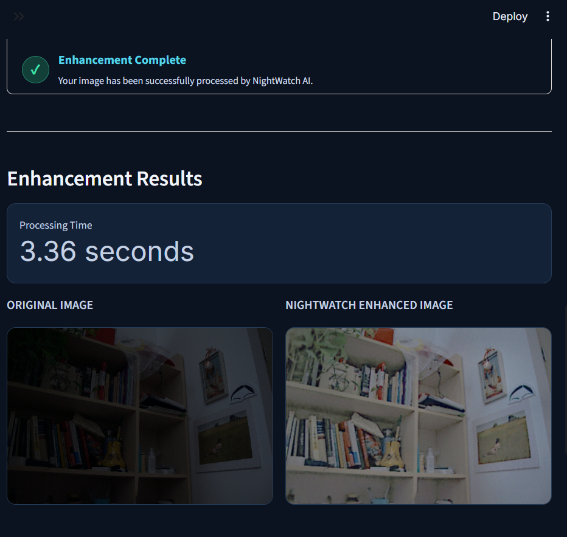

# 🌙 NightWatch AI

### Adaptive Low-Light Image Enhancement Using Residual Attention U-Net

**See beyond the darkness.**

NightWatch AI is a deep learning-based image enhancement system designed to improve the visibility and visual quality of photographs captured under poor lighting conditions.

The system combines a custom Residual Attention U-Net with an adaptive image refinement pipeline to enhance brightness, local contrast, and colour appearance while preserving important image details.

---

## 📌 1. Project Overview

NightWatch AI aims to address the challenges of low-light photography using deep learning and adaptive image processing techniques.

The project integrates:

- Residual Attention U-Net for deep learning-based image enhancement.
- Adaptive gamma correction for luminance improvement.
- CLAHE for local contrast enhancement.
- HSV-based saturation adjustment for improved colour appearance.
- Streamlit-based interactive application for image processing.

## 🎯 2. Project Objectives

- Enhance images captured in low-light environments.
- Improve brightness, contrast, and colour visibility.
- Preserve important image structures and details.
- Explore different deep learning architectures and training experiments.
- Develop an interactive application for image enhancement.
- Evaluate enhancement performance using quantitative metrics.

## 🏗️ 3. System Architecture

The NightWatch AI pipeline consists of the following stages:

1. **Image Input:** Upload a low-light RGB photograph.
2. **Preprocessing:** Resize and normalize the input image.
3. **Deep Learning Enhancement:** Generate an enhanced prediction using the trained Residual Attention U-Net.
4. **Adaptive Refinement:** Apply image-dependent gamma correction and CLAHE.
5. **Saturation Adjustment:** Apply controlled HSV saturation enhancement.
6. **Final Output:** Resize the enhanced result to the original image dimensions and display the comparison.

## 🧠 4. Model Architecture

The selected model is a custom Residual Attention U-Net.

**Model specifications:**

- Architecture: Residual Attention U-Net
- Input dimensions: 256 × 384 × 3
- Output dimensions: 256 × 384 × 3
- Total parameters: 2,082,423
- Selected checkpoint: `best_resunet_exp5.keras`

The architecture incorporates:

- Residual convolutional blocks.
- Attention gates for skip connections.
- Encoder-decoder structure.
- Residual image correction output.

## ✨ 5. Adaptive Image Refinement

After deep learning inference, the predicted image passes through an adaptive refinement pipeline.

### Gamma Correction

Uses an image-dependent gamma value to adjust image luminance.

### CLAHE

Contrast Limited Adaptive Histogram Equalization improves local contrast and visibility.

### Saturation Adjustment

A controlled HSV saturation multiplier of 1.75 improves colour appearance.

These operations are integrated into the final enhancement pipeline.

## 🧪 6. Dataset and Experimental Evaluation

The project uses the LOL (Low-Light) dataset, containing paired low-light and normal-light images.

- Training and validation: `our485`
- Independent evaluation: `eval15`

The dataset is not included in this repository.

### Experimental Results

The selected model was evaluated on the independent evaluation set.

| Evaluation Metric | Baseline Model | Adaptive Pipeline |
| ----------------- | -------------: | ----------------: |
| PSNR              |       13.57925 |          15.29112 |
| SSIM              |        0.68909 |           0.73463 |
| MAE               |        0.19584 |           0.15734 |

The adaptive refinement pipeline improved all three reported metrics in this evaluation.

## 🛠️ 7. Technologies Used

| Category             | Technologies      |
| -------------------- | ----------------- |
| Programming Language | Python            |
| Deep Learning        | TensorFlow, Keras |
| Image Processing     | OpenCV            |
| Numerical Computing  | NumPy             |
| Data Analysis        | Pandas            |
| Visualization        | Matplotlib        |
| Frontend             | Streamlit         |
| Model Format         | Keras             |

## 💻 8. Application Features

- Dark-themed interactive dashboard.
- Low-light image upload.
- Deep learning-based image enhancement.
- Adaptive image refinement.
- Original and enhanced image comparison.
- Image dimensions and file-size information.
- Processing-time display.
- Model architecture and inference information.

## 📂 9. Project Structure

```text
NightWatch-AI/
│
├── app.py
├── data_loader.py
├── NightWatch_Development.ipynb
│
├── models/
│   ├── adaptive_refinement.py
│   ├── advanced_losses.py
│   ├── experiment5_losses.py
│   ├── experiment6_losses.py
│   ├── losses.py
│   ├── resunet.py
│   └── unet.py
│
├── checkpoints/
│   └── best_resunet_exp5.keras
│
├── logs/
├── results/
├── screenshots/
│
├── train.py
├── train_resunet.py
├── train_resunet_aug.py
├── train_resunet_exp5.py
├── train_resunet_exp6.py
├── train_resunet_perceptual.py
│
├── evaluate_resunet.py
├── evaluate_resunet_aug.py
├── .gitignore
└── README.md
```

## 🚀 10. Installation and Execution

### Step 1: Clone the repository

```bash
git clone https://github.com/Rimsha-Katoch/NightWatch-AI.git
cd NightWatch-AI
```

### Step 2: Create a virtual environment

```bash
python -m venv nightwatch_env
```

### Step 3: Activate the environment

Windows PowerShell:

```powershell
.\nightwatch_env\Scripts\Activate.ps1
```

### Step 4: Install dependencies

```bash
pip install -r requirements.txt
```

### Step 5: Run the application

```bash
streamlit run app.py
```

**Note:** The `requirements.txt` file will be added separately. The dataset is not included, and the selected trained model checkpoint is included in the repository.

## 📸 11. Application Screenshots

### Home Dashboard

The main NightWatch AI dashboard and platform overview.


### How NightWatch Works

Overview of the image enhancement workflow.


### Model Architecture

Details of the Residual Attention U-Net architecture.


### Adaptive Refinement

The adaptive gamma correction, CLAHE, and saturation adjustment pipeline.


### Image Enhancement Workspace

Upload a low-light photograph for enhancement.



### Original Image Information

Displays the dimensions, file size, and original image preview.


### Enhancement Results

Visual comparison between the original and NightWatch-enhanced images.



## 🔮 12. Future Scope

- Extension to low-light video enhancement.
- Real-time image enhancement.
- Further inference speed optimization.
- Evaluation on additional low-light datasets.
- Deployment as a cloud-based application.

## 👥 13. Project Repository

**GitHub:** https://github.com/Rimsha-Katoch/NightWatch-AI

---

**NightWatch AI — Making low-light images clearer through adaptive deep learning.**
