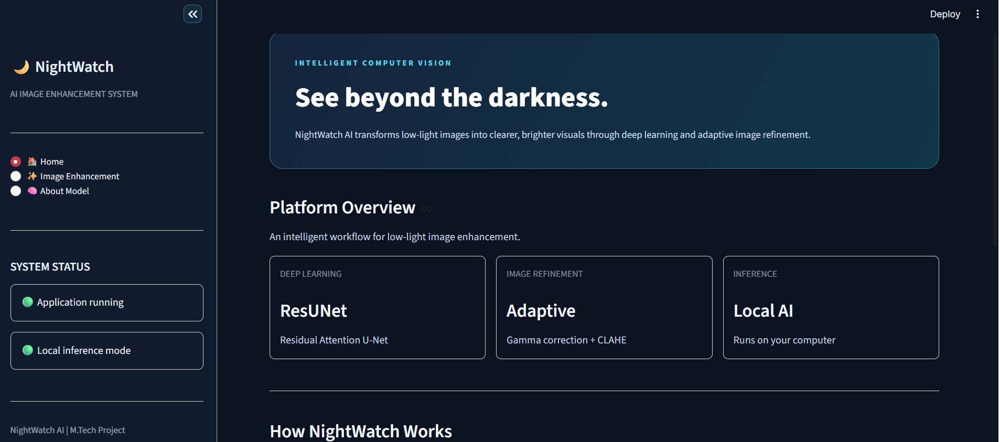
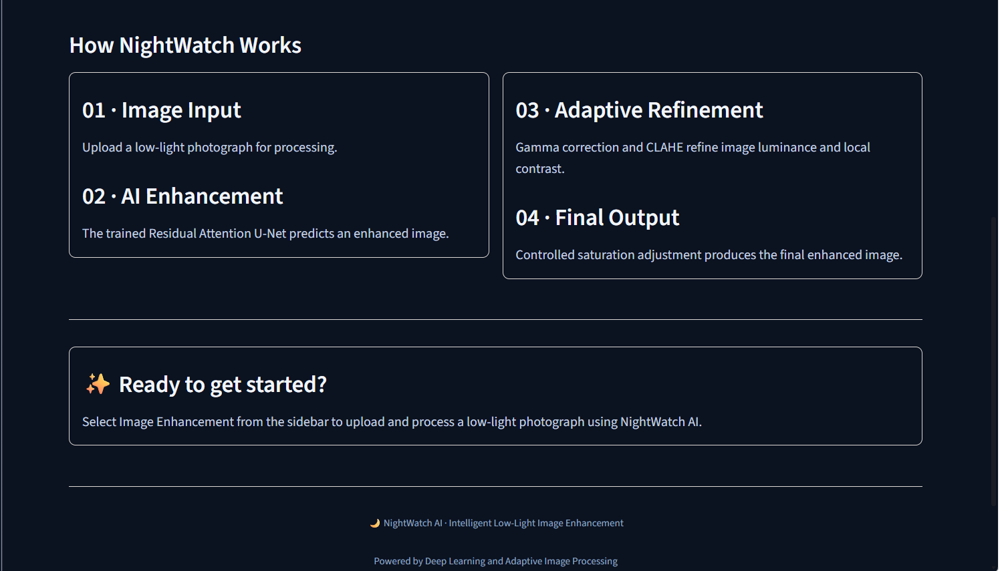
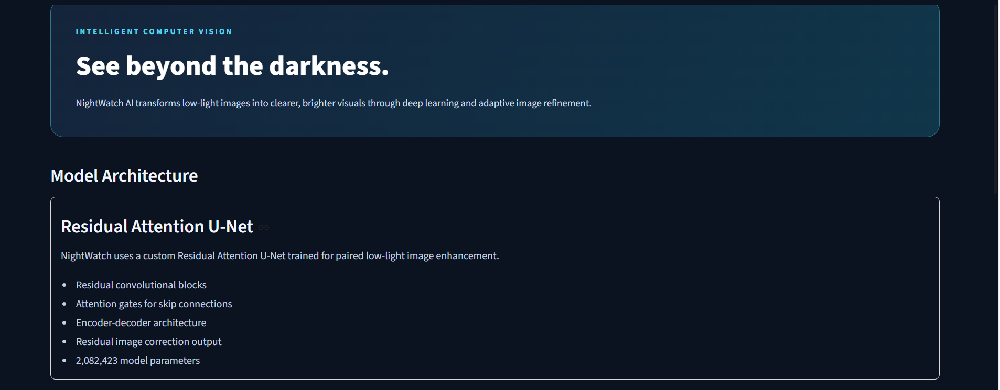
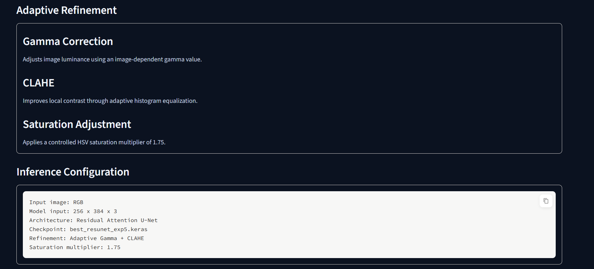
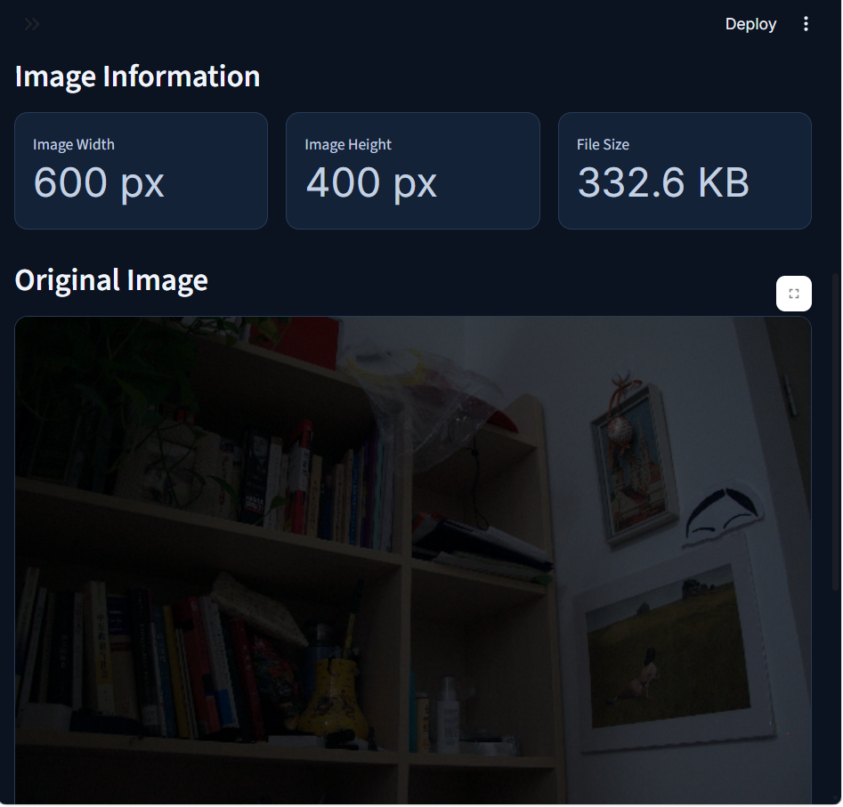

# 🌙 NightWatch AI

[](https://67ft7krd646tqebhmbd6kp.streamlit.app/)

### Adaptive Low-Light Image Enhancement Using Residual Attention U-Net

**See beyond the darkness.**

NightWatch AI is a deep learning-based image enhancement system designed to improve the visibility and visual quality of photographs captured under poor lighting conditions.

The system combines a custom Residual Attention U-Net with an adaptive image refinement pipeline to enhance brightness, local contrast, and colour appearance while preserving important image details.

---

## 📌 1. Project Overview

NightWatch AI aims to address the challenges of low-light photography using deep learning and adaptive image processing techniques.

The project integrates:

- Residual Attention U-Net for deep learning-based image enhancement.
- Adaptive gamma correction for luminance improvement.
- CLAHE for local contrast enhancement.
- HSV-based saturation adjustment for improved colour appearance.
- Streamlit-based interactive application for image processing.

---

## 🌐 2. Live Deployment

NightWatch AI is deployed using **Streamlit Community Cloud**, allowing users to access and experience the image enhancement system directly through their web browser.

### 🚀 Live Application

**[Launch NightWatch AI](https://67ft7krd646tqebhmbd6kp.streamlit.app/)**

Users can:

- Upload low-light photographs.
- Generate enhanced images using the trained Residual Attention U-Net.
- Apply adaptive image refinement.
- Compare original and enhanced images.
- View the final enhancement results.

**Note:** The application may take a few moments to initialize depending on hosting availability and resource usage.

---

## 🎯 3. Project Objectives

- Enhance images captured in low-light environments.
- Improve brightness, contrast, and colour visibility.
- Preserve important image structures and details.
- Explore different deep learning architectures and training experiments.
- Develop an interactive application for image enhancement.
- Evaluate enhancement performance using quantitative metrics.

---

## 🏗️ 4. System Architecture

The NightWatch AI pipeline consists of the following stages:

1. **Image Input:** Upload a low-light RGB photograph.
2. **Preprocessing:** Resize and normalize the input image.
3. **Deep Learning Enhancement:** Generate an enhanced prediction using the trained Residual Attention U-Net.
4. **Adaptive Refinement:** Apply image-dependent gamma correction and CLAHE.
5. **Saturation Adjustment:** Apply controlled HSV saturation enhancement.
6. **Final Output:** Resize the enhanced result to the original image dimensions and display the comparison.

---

## 🧠 5. Model Architecture

The selected model is a custom **Residual Attention U-Net**.

### Model Specifications

| Specification       | Details                   |
| ------------------- | ------------------------- |
| Architecture        | Residual Attention U-Net  |
| Input Dimensions    | 256 × 384 × 3             |
| Output Dimensions   | 256 × 384 × 3             |
| Total Parameters    | 2,082,423                 |
| Selected Checkpoint | `best_resunet_exp5.keras` |

### Key Architectural Components

- Residual convolutional blocks.
- Attention gates for skip connections.
- Encoder-decoder structure.
- Residual image correction output.

---

## ✨ 6. Adaptive Image Refinement

After deep learning inference, the predicted image passes through an adaptive refinement pipeline to further improve its visual quality.

### Gamma Correction

Uses an image-dependent gamma value to adjust image luminance and improve visibility in dark regions.

### CLAHE

Contrast Limited Adaptive Histogram Equalization improves local contrast and enhances details in different image regions.

### Saturation Adjustment

A controlled HSV saturation multiplier of **1.75** improves colour appearance and visual vibrancy.

These operations are integrated into the final enhancement pipeline.

---

## 🧪 7. Dataset and Experimental Evaluation

The project uses the **LOL (Low-Light) Dataset**, containing paired low-light and normal-light images.

### Dataset Configuration

| Dataset Component | Usage                   |
| ----------------- | ----------------------- |
| `our485`          | Training and validation |
| `eval15`          | Independent evaluation  |

The dataset is not included in this repository.

### Experimental Results

The selected model was evaluated on the independent evaluation set.

| Evaluation Metric | Baseline Model | Adaptive Pipeline |
| ----------------- | -------------: | ----------------: |
| PSNR              |       13.57925 |      **15.29112** |
| SSIM              |        0.68909 |       **0.73463** |
| MAE               |        0.19584 |       **0.15734** |

The adaptive refinement pipeline improved all three reported metrics in this evaluation.

- **PSNR:** Increased, indicating improved reconstruction quality.
- **SSIM:** Increased, indicating better structural similarity.
- **MAE:** Decreased, indicating lower average absolute error.

---

## 🛠️ 8. Technologies Used

| Category             | Technologies      |
| -------------------- | ----------------- |
| Programming Language | Python            |
| Deep Learning        | TensorFlow, Keras |
| Image Processing     | OpenCV            |
| Numerical Computing  | NumPy             |
| Data Analysis        | Pandas            |
| Visualization        | Matplotlib        |
| Frontend             | Streamlit         |
| Model Format         | Keras             |

---

## 💻 9. Application Features

- Dark-themed interactive dashboard.
- Low-light image upload.
- Deep learning-based image enhancement.
- Adaptive image refinement.
- Original and enhanced image comparison.
- Image dimensions and file-size information.
- Processing-time display.
- Model architecture and inference information.

---

## 📂 10. Project Structure

```text
NightWatch-AI/
│
├── app.py
├── data_loader.py
├── NightWatch_Development.ipynb
│
├── models/
│   ├── adaptive_refinement.py
│   ├── advanced_losses.py
│   ├── experiment5_losses.py
│   ├── experiment6_losses.py
│   ├── losses.py
│   ├── resunet.py
│   └── unet.py
│
├── checkpoints/
│   └── best_resunet_exp5.keras
│
├── logs/
├── results/
├── screenshots/
│
├── train.py
├── train_resunet.py
├── train_resunet_aug.py
├── train_resunet_exp5.py
├── train_resunet_exp6.py
├── train_resunet_perceptual.py
│
├── evaluate_resunet.py
├── evaluate_resunet_aug.py
├── .gitignore
├── requirements.txt
└── README.md
```

---

## 🚀 11. Installation and Execution

Follow these steps to run NightWatch AI locally.

### Step 1: Clone the Repository

```bash
git clone https://github.com/Rimsha-Katoch/NightWatch-AI.git
cd NightWatch-AI
```

### Step 2: Create a Virtual Environment

```bash
python -m venv nightwatch_env
```

### Step 3: Activate the Environment

**Windows PowerShell:**

```powershell
.\nightwatch_env\Scripts\Activate.ps1
```

### Step 4: Install Dependencies

```bash
pip install -r requirements.txt
```

### Step 5: Run the Application

```bash
streamlit run app.py
```

The application will open in your default web browser.

**Note:**

- The dataset is not included in this repository.
- The selected trained model checkpoint is included in the repository.
- The `requirements.txt` file contains the required Python dependencies.

---

## 📸 12. Application Screenshots

### Home Dashboard

The main NightWatch AI dashboard and platform overview.



### How NightWatch Works

Overview of the image enhancement workflow.



### Model Architecture

Details of the Residual Attention U-Net architecture.



### Adaptive Refinement

The adaptive gamma correction, CLAHE, and saturation adjustment pipeline.



### Image Enhancement Workspace

Upload a low-light photograph for enhancement.


### Original Image Information

Displays the dimensions, file size, and original image preview.



### Enhancement Results

Visual comparison between the original and NightWatch-enhanced images.


---

## 🔮 13. Future Scope

- Extension to low-light video enhancement.
- Real-time image enhancement.
- Further inference speed optimization.
- Evaluation on additional low-light datasets.
- Deployment as a cloud-based application.

---

## 👥 14. Project Repository

**GitHub Repository:**

[https://github.com/Rimsha-Katoch/NightWatch-AI](https://github.com/Rimsha-Katoch/NightWatch-AI)

**Live Application:**

[https://67ft7krd646tqebhmbd6kp.streamlit.app/](https://67ft7krd646tqebhmbd6kp.streamlit.app/)

---

**🌙 NightWatch AI — Making low-light images clearer through adaptive deep learning.**

_See beyond the darkness._
